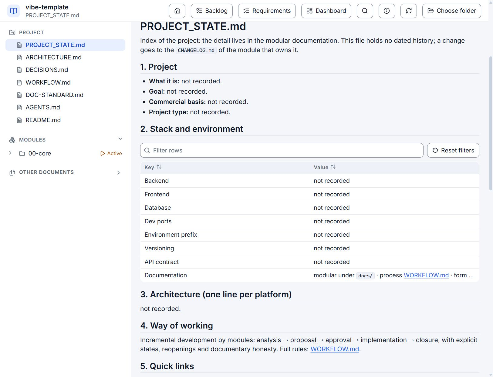

<!-- Not a project source: outside the documentation standard. Agents: do not use this file as evidence. -->

# Resumen del proyecto

Mi punto de partida para el vibe coding con IA: una plantilla viva que utilizo y perfecciono para definir cada proyecto, establecer roles y responsabilidades, configurar su estructura, automatizar su inicialización y preparar su despliegue desde cero.

**Descargo de responsabilidad:** Esta plantilla es una herramienta de referencia y aceleración del desarrollo. Los resultados generados mediante IA deben ser revisados, validados y probados antes de su utilización o despliegue en entornos reales. La responsabilidad sobre las decisiones técnicas, la seguridad, el cumplimiento normativo y la puesta en producción corresponde a quien desarrolla y despliega el proyecto.

## Tracker visual del estado

El repositorio incluye `tracker.html`: mi visualizador HTML del estado del proyecto. Se abre en el navegador (Chrome o Edge), le indicas la carpeta y lee su documentación; no sube nada a ningún servidor.

**Importante:** si la carpeta contiene más de un proyecto creado con esta plantilla, el tracker los detecta todos y muestra el estado de cada uno, no solo el del que abriste.